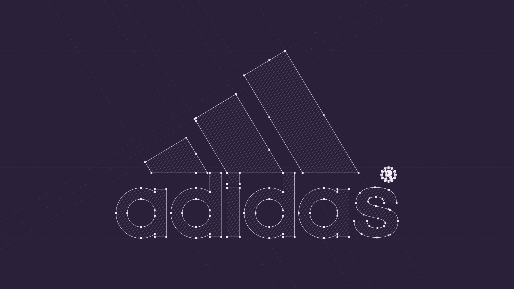
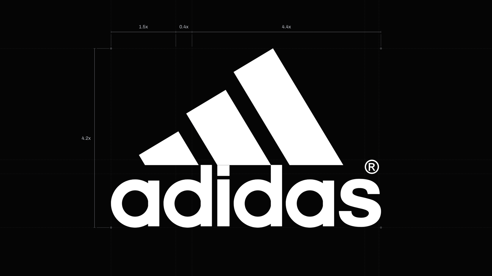

# Logo Grid Generator

A compact workspace for studying logo geometry and making construction films. Import an SVG, inspect its anchors and Bézier handles, study dimensions and tangents with Paper.js, and export the construction as editable vectors, a still image, or an H.264 MP4.

Designed and developed by [Coker Oluwafemi](https://cokeroluwafemi.com/).

## Generator

- Reference-inspired split workspace: preview on the left, visual construction cards and controls on the right. Persistent light and dark interface modes, responsive layout, and Archivo typography.
- Bézier traces, dimension guides, tangent spines, and local radius circles calculated from the actual paths using Paper.js. Tangent spines follow the local tangents and extend beyond the canvas in both directions; they are not an inferred medial-axis skeleton. Radius circles approximate local curvature; they are not a claim about how the logo was originally constructed.
- Draggable paths and control handles, anchors, bounding boxes, grid snapping, alignment guides, ruler guides, undo, and redo.
- Paper, Blueprint, and Ink palettes, customizable colors, stroke widths, anchor sizes, and square, column, or dot grids.
- Construction preview with play/pause, scrubbing, and a clean-logo or construction-hold ending.
- SVG, PNG, and MP4 exports with custom pixel dimensions and common square, portrait, story, landscape, and 4K presets.

## Run locally

Requires Node.js 22 or later. No API keys or external services are needed. Fonts and dependencies are bundled locally; uploaded artwork stays in the browser.

```sh
npm ci
npm run dev
```

```sh
npm run typecheck
npm run test:unit
npm test # Also requires Chromium or CHROME_BIN=/path/to/chrome
npm run build
npm run preview
```

The production website is generated in `dist/`. Deploy that directory to a static host. `base: './'` supports subdirectory hosting. The build also updates the bundled, ready-to-run root `index.html`, which supports this repository's existing branch-based GitHub Pages deployment without a separate Node build on GitHub. The editable HTML entry is `app.html`; do not edit the generated root `index.html` directly. The development server automatically serves `app.html` at `/`. Netlify uses `netlify.toml` to run `npm run build` with Node 22 and publish `dist/`.

## Import artwork

Use an SVG up to 15 MB. Choose **Upload your logo** or drag your own file onto the canvas; the preloaded artwork is an example. Live `<text>`, `<tspan>`, and `<textPath>` lettering is supported alongside paths, rectangles (including rounded corners), circles, ellipses, lines, polygons, and polylines, including nested group transforms, relative coordinates, repeated commands, smooth curves, quadratic curves, and elliptical arcs. Geometry is normalized into absolute line, cubic, and quadratic segments before editing.

Instances, symbols, clipping masks, gradients, filters, strokes and embedded images are prepared automatically. Simple geometry stays editable, and ordinary live text stays live in Inspect and Construction. Complex artwork is rendered and traced into construction contours; its rendered colours are retained for Original logo colours. Morph automatically traces unexpanded lettering. Upload a TTF, OTF, WOFF or WOFF2 font through Typography when the original font is unavailable. Uploaded fonts stay local and are embedded in exports; Archivo is bundled. Scripts and event handlers are removed, and linked images must be accessible to be embedded. See Import without manual preparation below for tracing precision and asset limits.

Drag a path to move it; drag its control points with Control handles enabled. Drag from a ruler to add a guide; drag it outside the canvas to remove it. Ctrl/⌘ Z undoes a geometry edit, Shift Ctrl/⌘ Z or Ctrl Y redoes it. Space plays or pauses construction. Keyboard shortcuts leave focused form inputs alone.

## Export

| Option         | Behavior                                                                         |
| -------------- | -------------------------------------------------------------------------------- |
| SVG            | Editable vector geometry at the supplied dimensions                              |
| PNG            | Raster image at the exact supplied dimensions, with optional transparency        |
| MP4            | H.264 construction animation, encoded one frame at a time                        |
| Dimensions     | Whole pixels, 16–8192 per side, up to 33 megapixels; MP4 dimensions must be even |
| Video duration | 3, 5, 8, 10, 15, 20, or 30 seconds                                               |
| Frame rate     | 24, 30, or 60 fps                                                                |
| Quality        | Standard or High bitrate, scaled to pixel count and frame rate                   |
| Finish         | Hold construction, or fade the construction layers to the logo                   |
| Guides         | Include or omit alignment and selected-path guides                               |

MP4 requires WebCodecs with an H.264 encoder, normally available in current Chrome and Edge over HTTPS or localhost. The app checks the requested encoder configuration before rendering. Codec support and maximum dimensions depend on the device; reduce resolution or frame rate if a configuration is unsupported. Figma's embedded browser may not expose video encoding; use the standalone web app for MP4 in that case.

Export uses fixed frame timestamps, encoder backpressure, regular keyframes, and MP4 fast-start metadata. Rendering speed does not change video timing. This avoids dropped frames from real-time screen recording and allows playback to start before the whole file downloads. It cannot guarantee buffer-free streaming on every connection or device. High-resolution rendering may take longer than the video duration and uses memory proportional to the output; progress and cancellation are provided. Video is opaque and contains no audio. PNG transparency and SVG transparency do not apply to MP4.

The selected visible construction layers are used in preview and export. The logo is fitted without distortion to the requested aspect ratio. Visible rulers export by default; uncheck Include rulers to omit them. The alignment-guide setting controls alignment overlays.

## Figma plugin

[Download the Figma development plugin ZIP](https://github.com/cokerf/Logo-Grid-Generator/raw/refs/heads/main/figma/logo-grid-figma-plugin.zip), extract it, and import its `manifest.json` in Figma Desktop. No Node installation is needed for the prebuilt ZIP.

The plugin uses the same bundled interface and geometry engine as the web app. It reads the current selection and can insert the styled construction as editable Figma vectors without replacing the source artwork. Select one vector, group, component, instance, or frame. Text is outlined during selection export. The SVG import limitations above also apply to Figma selections.

```sh
npm run build:plugin
```

This produces:

```text
figma/dist/code.js
figma/dist/ui.html
figma/logo-grid-figma-plugin.zip
```

In Figma Desktop, open **Plugins → Development → Import plugin from manifest…** and select this repository's `manifest.json`. Keep `figma/dist/` next to the manifest at its existing path. The UI bundles its scripts, styles, and fonts and requests no network domains. Use the **Export** tab's **Insert editable construction in Figma** button to add the construction beside the selected artwork.

The repository originally contained a placeholder plugin ID. `manifest.json` retains that development ID; replace it with the ID assigned by Figma when creating your own plugin before Community submission. The build is an installable development plugin, not a Community publication. Test selection and insertion in Figma Desktop before publishing.

## Project structure

- `App.tsx` — workspace state, geometry editing, preview, and Figma UI bridge.
- `components/Canvas.tsx` — interactive SVG canvas, rulers, and guides.
- `components/AnalysisLayers.tsx` — construction overlays.
- `services/svgParser.ts` — sanitized geometry import and path normalization.
- `services/geometry.ts` — Paper.js curvature and tangent analysis.
- `services/exporter.ts` — shared construction timeline, still export, WebCodecs, and MP4 muxing.
- `code.ts` — Figma selection and editable vector insertion.
- `scripts/build-plugin.mjs` — standalone Figma plugin build, development ZIP, and prebuilt Pages entry.
- `app.html` — editable website entry; root `index.html` is generated.

Built with React, TypeScript, Vite, Paper.js, svgpath, WebCodecs, and mp4-muxer. Third-party packages retain their respective licenses.

## Validation

`npm run test:unit` checks SVG command normalization, arc conversion, subpath handling, Paper.js curvature, and export dimensions. `npm run test:browser` needs a Chromium-based browser (`chromium` by default, or set `CHROME_BIN`) and verifies DOM import, UI controls, construction frames, cancellation, and a real 1080 × 1350 H.264 export. GitHub Actions runs both suites and retains the sample MP4, a UI screenshot, browser results, and the packaged Figma development plugin as build artifacts.

The example is a local vector tracing of the Coker Oluwafemi logo supplied by the author. It does not depend on fetching the reference JPG at runtime. Canvas grids cover the full output canvas at every aspect ratio, including stills, construction preview, and video; rulers overlay the workspace only. Interface theme changes do not overwrite artwork colours.

## Affinity add-on

The build includes a native scripting add-on for Affinity by Canva 3.3.1+ and a bundled standalone generator. Download it from the application footer or `downloads/logo-grid-affinity.zip`. Import `Logo-Grid-Generator.js` into Scripting Studio, select curve layers, and run the script to add editable construction layers with a native options dialog. It uses Affinity's supported scripting SDK, adds all layers in one undo step, and leaves the source intact. Native execution still needs an Affinity Desktop installation and alignment check. See `affinity/README.md` for installation and scope.

Light mode is the default. An explicit choice of dark mode is saved for subsequent visits; older automatic dark-mode preferences are reset once when moving to the new theme preference key. The example logo is unchanged.

## Motion presets

The Export tab includes Technical build (8s), Precision close-up (10s), Geometry tour (12s), and Quiet reveal (8s). Choosing a preset sets its construction layers, duration, camera treatment, and ending, then starts the preview. You can change the layers, duration, resolution, frame rate, quality, and ending afterward. Close-ups use smooth pans and a pullback; every preset settles into the original framing for a final hold. Camera and construction timing are shared between preview and the deterministic MP4 exporter. Interface controls and preset names are not included in the video.


## Curated logo library

The web app offers 11 selected WorldVectorLogo brands plus the bundled Coker logo. No random or search endpoints are used. Each brand click checks one SVG detail through `/.netlify/functions/worldvectorlogo`; the server accepts only the curated slugs in `services/logoCatalog.ts`. Successful responses are cached in the Netlify CDN (seven days), the warm function instance and the browser (seven days). The initial canvas chooses a curated logo and a coordinated colour drawing preset, shows its local snapshot immediately, and checks its SVG through the API. An unavailable provider or 429 silently restores the Coker fallback. A later response cannot overwrite artwork the user has already selected. All 11 curated brands also ship as verified snapshots retrieved through the configured API, so thumbnails and Shuffle logo & style need no requests. The library starts collapsed. Click a brand to load its snapshot immediately and check the API; the selected thumbnail identifies the brand. Provider status and path counts stay out of the interface. The Ethereum entry was removed because its clipping/instances were incompatible with the importer. For Adidas, Honda and The North Face, only their known white full-canvas EPS backing rectangles are removed before loading; actual white logo details remain intact. This keeps background rectangles out of hatching and geometry measurements.

To connect your account, open the existing Netlify project's **Project configuration → Environment variables** and add `WORLDVECTORLOGO_API_KEY` with your key, enabled for the **Functions** scope and **Production** context. Save it, then redeploy. Do not prefix it with `VITE_`, commit it, or paste it into the generator. The function sends it to WorldVectorLogo using the Authorization Bearer header; the browser never receives it.

Missing credentials, 429s, provider errors, timeouts, and unsupported SVGs restore the local Coker example. There is no automatic retry loop. After a 429 the browser pauses provider requests for five minutes; warm server instances respect the provider's reset/cooldown. Cached logos remain available. The Figma and standalone builds include the curated snapshots and support local shuffling; API checks are hosted in the Netlify app.

## Rulers and outline defaults

Logo fill and Original logo colours start off. Enable either in Style as needed. **Export → Include rulers** is checked initially and includes rulers only when **Geometry → Rulers** is on. This applies to SVG, PNG, construction previews and MP4. Rulers remain fixed to the output frame and update their source-coordinate labels during camera zooms. Dimension guide measurements are in SVG user units (`u`), not output pixels. Dimension guides replace the former curvature comb, including editable dimension brackets in the Affinity add-on.


### Shuffle controls

**Shuffle logo & style** chooses a different logo from the 11 preloaded brands and Coker, then applies a coordinated palette, grid, geometry detail, stroke weights and motion preset. **Shuffle style** keeps the current SVG. Both keep output dimensions, fps, quality and ruler preferences; stroke weights adapt to the SVG size. Logo fill and Original logo colours remain off. Dense logos avoid the most crowded overlays. The randomizer has fourteen coordinated palettes and stays inside the fixed curated pool; it never calls a random/search API or starts an automatic retry loop.


## Reference drawing styles

Open **Drawing** for ten editable presets, including **Plum hatch**, **Measured mono**, **Drafting paper**, **Precision blue**, **Cobalt & butter**, **Coral & aubergine**, **Lagoon & mint**, **Orchid & grape**, **Citron measures**, and **Tomato measures**. Presets apply to the loaded SVG; they never replace its geometry. Plum hatch uses diagonal path shading, dotted extensions and square anchor markers. Measured mono uses a filled mark, thin horizontal/vertical guides, hollow corner circles and proportion labels.

- Hatching is an SVG pattern inside each original path, with its fill rule preserved. Adjust angle, spacing, stroke weight, opacity and colour. Hatching is independent of the Logo fill switch and also works on live SVG text.
- Extended guides can follow path extents or anchor positions. Choose orthogonal, diagonal or both directions, with solid, dashed or dotted strokes. Diagonals extend real straight edges; a custom angle is used for logos without straight diagonals. Guides intersect the full canvas boundary and are deduplicated/capped to avoid excessive geometry.
- Anchor markers and corner markers support square, circle, cross and diamond shapes. Corner markers can be hollow or solid, with configurable clear space.
- Proportion labels use `x = logo height / Units across logo height`. By default, disconnected contours are measured as components, hole contours are excluded, and aligned rows are handled separately. Guides and ratio labels follow real component edges and gaps, including compound-path wordmarks. Enclosing frames do not hide the spacing inside them. An optional percentage field overrides the detected dividers. The labels show measured ratios and do not imply the logo was originally designed with those proportions.

All drawing layers are native SVG elements, so web SVG/PNG exports, construction previews and MP4 films share the same result. Hatching fades in with the artwork; guide lines, markers and measurements enter through the construction timeline. Motion preset selection preserves active Drawing layers and styling. These controls are also included in the bundled standalone generator. The native Affinity script retains its basic curve construction controls; use its bundled generator for these additional drawing styles and film exports.

### Exported examples

These 1920 × 1080 images were exported directly from the web app using the curated Adidas logo. Brand artwork belongs to its respective owner; the examples demonstrate the generator's construction styling.






## Quick actions and interface

Right-click the studio or canvas for shuffle, import, play/pause, inspect, grid, ruler and tangent toggles, theme switching, PNG/SVG/MP4 export, and the Coker fallback. The menu supports arrow keys, Enter and Escape, stays inside the window, and does not intercept text-field editing. A right-click never starts a path/handle drag. Interface panels, controls and menus have sharp corners. Provider messages, path/anchor counts and temporary style labels are not displayed.

The Style tab has fourteen coordinated palettes with matched backgrounds, logo ink, hatch colour, guides and markers. Startup chooses a colourful drawing style; the light interface theme remains the default. Measured mono remains available as a deliberate monochrome option.

### Logo evolution with Morph

Open **Morph**, between Inspect and Construction. The current logo becomes the first SVG; upload a second SVG or choose one from the curated library. Either input can be replaced independently, and **Swap** reverses their order without changing your original artwork.

Evolution, Slow study and Continuous loop presets coordinate timing and easing. Scrub any frame, play/pause, set duration and endpoint holds, or reverse the transition. Active drawing colours, hatching, construction guides, markers, tangents and rulers follow the evolving geometry. SVG and PNG save the current frame; **Export morph** saves a frame-by-frame H.264 MP4 using the shared export dimensions, frame rate, quality and ruler settings.

Paper.js matches contours by size and location, aligns their starting points, and grows or collapses unmatched parts. Original vector contours are preserved at both endpoints; intermediate contours are sampled. Different logos can have very different structures, so automatic correspondence may produce intersections during a transition. Uploaded live text and textPath are automatically outlined for a geometric morph. Existing live text remains editable in Inspect and Construction.

Randomized styles always leave tangent spines off. Enable them manually in Construction layers or from the right-click menu whenever needed.


### Import without manual preparation

The editor now automatically prepares SVG instances, symbols, clipping paths, masks, stroke artwork, gradients, patterns, filters and embedded images. Ordinary paths stay editable, and ordinary text/textPath stays live in Inspect and Construction. Morph automatically traces unexpanded lettering into glyph contours.

When a file needs rendering, the browser resolves its visible appearance at up to 2048 pixels on the longest side, and Paper.js simplifies the traced silhouette into construction paths. This is a visual approximation for effect-heavy artwork; the original rendered colours remain available through Logo fill and Original logo colours. A soft mask produces a thresholded construction outline while the original rendering retains its transparency. Linked images are fetched and embedded when their server permits it. Broken XML, missing assets and unavailable fonts cannot be reconstructed from the file alone; upload its font or include its linked images where needed. Files up to 15 MB are supported.

The refreshed workspace uses a slimmer toolbar, clear artwork controls, larger settings text, a compact typography disclosure, and one set of construction layer switches. Light and dark themes retain sharp edges throughout.

### Frameworks, full colour and retained grids

Drawing → Logo appearance switches between Outline, Hatched, Solid colour and Original colours. Original colours enables the logo fill and takes precedence over hatching while keeping the construction overlays. Style → Original logo colours also activates the fill in one action. Palette changes preserve the original-colour choice.

Drawing → Construction frameworks adds Modular, Isometric, Radial, Golden ratio, Rule of thirds and Baseline overlays. Choose the canvas or logo bounds, then set divisions, rotation, offsets, line style, colour, opacity and weight. Reference circles and diagonal cross-lines are optional. These are editable proportional references, not claims that a logo follows the golden ratio or any other system. They render through the shared canvas in stills, construction films and Morph.

Export → Include canvas grid is enabled by default. It exports a grid that is switched on in the workspace and retains it through a clean video ending. Disable the export checkbox to omit it while keeping it visible in the editor. Tangent spines now default to 14% opacity with a thinner stroke; enable them manually, then adjust their opacity, weight and line style in Geometry. Shuffling never enables tangent spines.
